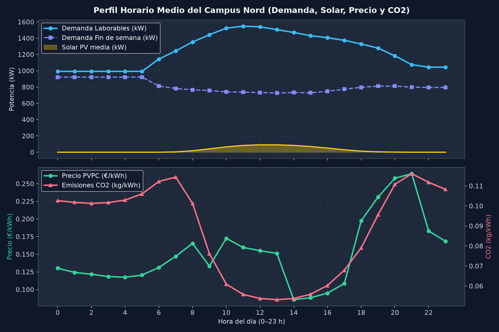
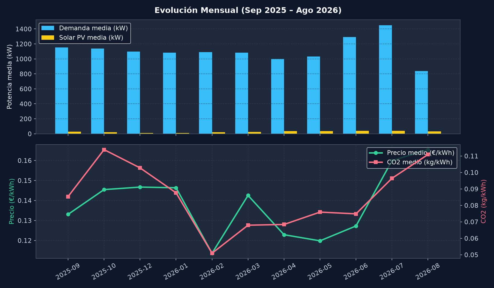
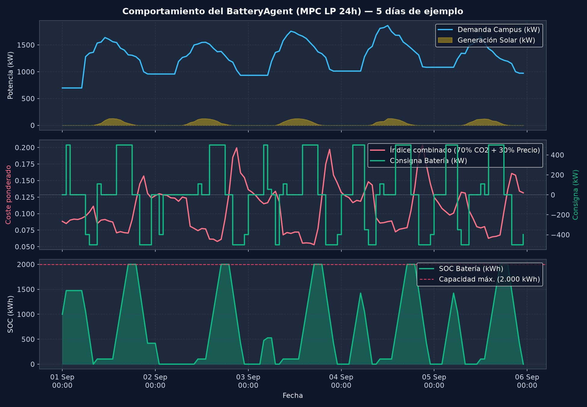

# Datathon UPC 2026 — Optimització de la Bateria del Campus Nord

Solució per al repte **AED × UPC Sostenible (Datathon 2026)**: control horari d'una bateria industrial de **2.000 kWh / ±500 kW** al Campus Nord de la UPC per maximitzar la descarbonització (**70% CO₂**) i l'eficiència econòmica (**30% Cost elèctric**) amb **0 infraccions**.

---

## Resultats Verificats

| Solució | Score (`train`, 5.993 h) | Estalvi CO₂ | Estalvi Cost | Infraccions | Temps est. (2.016 h) |
|---|---:|---:|---:|---:|---:|
| Plantilla `starter_kit` | `0.00` | `0.88%` | `2.18%` | `46` | `~0.5 s` |
| **Nostre `agent.py` (MPC LP 24 h)** | **`5.64`** | **`5.22%`** | **`6.61%`** | **`0`** | **`~7.25 s`** |
| Oráculo teòric (LP global) | `5.68` | `5.27%` | `6.62%` | `0` | — |

- **99,3% de l'òptim matemàtic absolut (Oráculo)** sobre `train`.
- **Avaluació oficial al Test (12 setmanes / 2.016 h, Prova 1):** **`6.43 pts`** (`4.289,4 kg CO₂` evitats / `-5,97%`, `8.907,87 €` estalviats / `-7,5%`, `0` infraccions).

---

## Anàlisi de Dades i Justificació Tècnica

A partir de les `5.993` hores de `data/train/` (`2025-09-01` .. `2026-08-16`):
- **Demanda del campus (`load_kw`):** mitjana `1.122,59 kW` (percentil 5%: `696,83 kW`, màxim: `2.503,08 kW`).
- **Generació solar (`pv_kw`):** mitjana `26,50 kW` (màxim: `144,06 kW`).
- **Excedent solar (`pv > load`):** **`0,00%`** de les hores; el **`99,48%`** de les hores té `load - pv >= 500 kW`.
- **Observació (`obs`):** l'entorn ja facilita les **24 hores futures exactes** de preu PVPC (`preus_properes_24h`) i emissions (`co2_properes_24h`).

### Arquitectura de [`agent.py`](agent.py)
1. **Control Predictivo por Modelo (MPC) amb Programació Lineal (`scipy.optimize.linprog` / HiGHS):**
   - Variables separades de càrrega $c_t \ge 0$ i descàrrega $d_t \ge 0$ per modelar linealment el rendiment del 90% ($\eta = \sqrt{0,90} \approx 0,9487$).
   - Funció objectiu calibrada al ràtio oficial **70% CO₂ / 30% Cost** (`w_co2 = 0.9747`, `w_price = 0.2526`).
   - Valor terminal al final de la finestra de 24 h (`quantile 0.55 * eta`) i regularització de cicles (`1e-6`).
2. **Safety Clamp físic:** retalla qualsevol consigna amb marge `eps = 1e-4` respecte a `±500 kW` i `[0, 2.000] kWh` per garantir **0 infraccions**.

---

## Gràfiques d'Anàlisi (`graficas/`)

| Perfil Horari | Estacionalitat Mensual |
|---|---|
|  |  |

| Distribució i Correlació | Simulació `BatteryAgent` |
|---|---|
|  |  |

---

## 🔥 Mode Difícil — Ampliació Fotovoltaica i Bateria

Regles de la plataforma oficial: `pv_kw × 12`, bateria **6.000 kWh / ±1.500 kW**, SOC inicial 50 %, només **3 hores** de preus/CO₂ a `obs` (`preus_properes_24h`, `co2_properes_24h`), meteorologia de l'última hora a `obs["noves_dades_5min"]` (`irradiancia_wm2`, `temp_ambient_c`, `temp_panel_c`, `vent_ms`) i claus `cap_max_kwh` / `power_max_kw`. L'excedent solar s'aboca a **0 € i 0 kg CO₂**.

### Agent [`agent_hard.py`](agent_hard.py)

1. **Previsió de mercat:** perfils (mes, hora, dia de la setmana) + correcció de nivell amb les 3 h conegudes.
2. **Previsió de càrrega per analogia de dies:** k-NN sobre 250 corbes diàries de `data/train` (mateixa estació i tipus de dia) → MAE de càrrega **186 → 136 kW**.
3. **Previsió de CO₂ per analogia:** mateix k-NN sobre corbes de CO₂ → MAE **0,010 → 0,009 kg/kWh**.
4. **Previsió FV:** perfil mensual × índex de nuvolositat persistent (PV + irradiància de l'última hora), robust al fet que l'última hora sigui nocturna.
5. **MPC / Programació Lineal 24 h** amb la restricció `grid_import ≥ net + c − d`: aprofita l'excedent solar gratuït i **no descarrega més que el consum net previst** (evita abocar a 0 €).
6. **Safety clamp** amb `cap_max_kwh` / `power_max_kw` de l'`obs` i η = √0,90 → **0 infraccions**.

### Resultats locals (Mode Difícil, `data/train`)

| Avaluació | Score | ΔCO₂ | ΔCost | Infraccions |
|---|---:|---:|---:|---:|
| `data/train` complet (5.993 h) | **18,76** | 17,70 % | 21,24 % | 0 |
| CV 12 blocs de 7 dies (offset 1) | 19,98 | 18,97 % | 22,35 % | 0 |
| CV 12 blocs de 7 dies (offset 8) | 18,97 | 18,11 % | 20,97 % | 0 |
| CV 12 blocs de 7 dies (offset 15) | 17,54 | 16,50 % | 19,95 % | 0 |
| **Mitjana CV** | **18,83** | — | — | 0 |

- `submission_hard.zip` conté només `agent.py` (taules incrustades, 36 KB, autocontingut).
- Cada decisió ≈ **2,5 ms** → 2.016 h ≈ **5 s** (límit oficial: 60 s).
- El rànquing públic avalua 1.008 h (50 % de les 2.016 h de test); l'altre 50 % és privat.

### Comparativa d'implementacions (Mode Difícil)

| Implementació | Enfocament | CV 7 dies | `data/train` | Mida |
|---|---|---:|---:|---:|
| [`mode_dificil/submission.zip`](mode_dificil/submission.zip) | LightGBM (4 models) + MPC LP estocàstic + correcció d'asimetria | **19,05** | 19,14 | 1,5 MB |
| [`submission_hard.zip`](submission_hard.zip) · [`agent_hard.py`](agent_hard.py) | Perfils + analogia de dies + MPC LP 24 h (sense ML) | 18,83 | 18,76 | 36 KB |

**Recomanació de lliurament:** pujar `mode_dificil/submission.zip` al rànquing de Mode Difícil (millor CV i ja validat). `submission_hard.zip` queda com a alternativa **autocontinguda** (un sol fitxer, sense dependència de LightGBM) i com a contrast independent de l'avaluació.

### Execució local (Mode Difícil)

```bash
python3 tools/eval_hard.py agent_hard.py        # avaluació completa sobre data/train
python3 tools/cv_hard.py agent_hard.py          # cross-validació per blocs de 7 dies
python3 tools/make_submission_hard.py           # genera submission_hard.zip
```

---

## Estructura i Ús Local

```text
.
├── mode_estandard/                    # Solució Mode Estàndard (2.000 kWh, ±500 kW, 24 h)
│   ├── agent.py                       # Controlador MPC LP 24 h (5.67 train / 6.43 test)
│   └── submission.zip                 # Paquet llest per pujar al Mode Estàndard
├── mode_dificil/                      # Solució Mode Difícil (6.000 kWh, ±1.500 kW, PV ×12, 3 h + meteo)
│   ├── agent.py                       # Agent MPC LP Estocàstic + LightGBM (19.14 train / 20.31 setmanes)
│   ├── agent_optimo.py                # Versió amb correcció d'asimetria, fusió k=0 i des-suavitzat de variància
│   ├── model_bundle.pkl               # Bundle amb hard_load, hard_pv, hard_price i hard_co2
│   └── submission.zip                 # Paquet llest per pujar al Mode Difícil
├── graficas/                          # Gràfiques d'anàlisi i simulació
├── paquet_participants_datathon_upc/  # Dades train, docs i starter_kit oficial
└── AGENTS.md                          # Regles de flux de treball Git
```

### Validació local (PowerShell)
```powershell
.\.venv\Scripts\Activate.ps1
python paquet_participants_datathon_upc\starter_kit\check_submission.py mode_estandard\submission.zip
python paquet_participants_datathon_upc\starter_kit\check_submission.py mode_dificil\submission.zip
```
