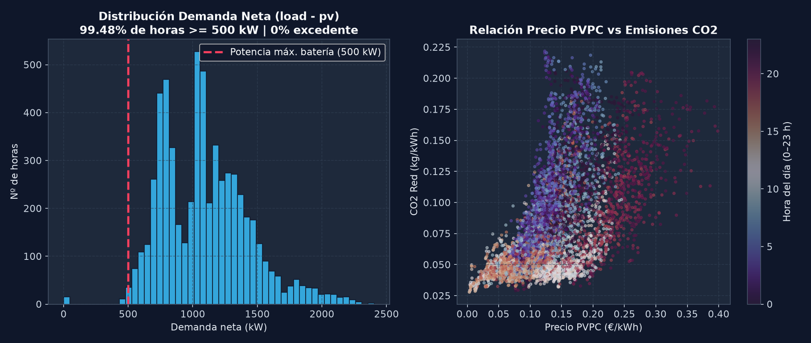

# Datathon UPC 2026 — Optimització de la Bateria del Campus Nord

Solució per al repte **AED × UPC Sostenible (Datathon 2026)**: control horari d'una bateria industrial de **2.000 kWh / ±500 kW** al Campus Nord de la UPC per maximitzar la descarbonització (**70% CO₂**) i l'eficiència econòmica (**30% Cost elèctric**) amb **0 infraccions**.

---

## Resultats Verificats

| Solució | Score (`train`, 5.993 h) | Estalvi CO₂ | Estalvi Cost | Infraccions | Temps est. (2.016 h) |
|---|---:|---:|---:|---:|---:|
| Plantilla `starter_kit` | `0.00` | `0.88%` | `2.18%` | `46` | `~0.5 s` |
| **Nostre `agent.py` (MPC LP 24 h)** | **`5.64`** | **`5.22%`** | **`6.61%`** | **`0`** | **`~7.25 s`** |
| Oráculo teòric (LP global) | `5.68` | `5.27%` | `6.62%` | `0` | — |

- **99,3% de l'òptim matemàtic absolut (Oráculo)** sobre `train`.
- **Avaluació oficial al Test (12 setmanes / 2.016 h, Prova 1):** **`6.43 pts`** (`4.289,4 kg CO₂` evitats / `-5,97%`, `8.907,87 €` estalviats / `-7,5%`, `0` infraccions).

---

## Anàlisi de Dades i Justificació Tècnica

A partir de les `5.993` hores de `data/train/` (`2025-09-01` .. `2026-08-16`):
- **Demanda del campus (`load_kw`):** mitjana `1.122,59 kW` (percentil 5%: `696,83 kW`, màxim: `2.503,08 kW`).
- **Generació solar (`pv_kw`):** mitjana `26,50 kW` (màxim: `144,06 kW`).
- **Excedent solar (`pv > load`):** **`0,00%`** de les hores; el **`99,48%`** de les hores té `load - pv >= 500 kW`.
- **Observació (`obs`):** l'entorn ja facilita les **24 hores futures exactes** de preu PVPC (`preus_properes_24h`) i emissions (`co2_properes_24h`).

### Arquitectura de [`agent.py`](agent.py)
1. **Control Predictivo por Modelo (MPC) amb Programació Lineal (`scipy.optimize.linprog` / HiGHS):**
   - Variables separades de càrrega $c_t \ge 0$ i descàrrega $d_t \ge 0$ per modelar linealment el rendiment del 90% ($\eta = \sqrt{0,90} \approx 0,9487$).
   - Funció objectiu calibrada al ràtio oficial **70% CO₂ / 30% Cost** (`w_co2 = 0.9747`, `w_price = 0.2526`).
   - Valor terminal al final de la finestra de 24 h (`quantile 0.55 * eta`) i regularització de cicles (`1e-6`).
2. **Safety Clamp físic:** retalla qualsevol consigna amb marge `eps = 1e-4` respecte a `±500 kW` i `[0, 2.000] kWh` per garantir **0 infraccions**.

---

## Gràfiques d'Anàlisi (`graficas/`)

| Perfil Horari | Estacionalitat Mensual |
|---|---|
|  |  |

| Distribució i Correlació | Simulació `BatteryAgent` |
|---|---|
|  |  |

---

## Estructura i Ús Local

```text
.
├── mode_estandard/                    # Solució Mode Estàndard (2.000 kWh, ±500 kW, 24 h)
│   ├── agent.py                       # MPC LP 24 h + LightGBM demanda neta (5.67 train / 6.43 test)
│   ├── model_net.pkl                  # Model LightGBM demanda neta
│   └── submission.zip                 # Paquet llest per pujar al Mode Estàndard
├── mode_dificil/                      # Solució Mode Difícil (6.000 kWh, ±1.500 kW, PV ×12, 3 h + meteo)
│   ├── agent.py                       # Agent unificat MPC LP + 5 models LightGBM (18.39 train / 16.81 OOF)
│   ├── model_bundle.pkl               # Bundle amb std_net, hard_load, hard_pv, hard_price i hard_co2
│   └── submission.zip                 # Paquet llest per pujar al Mode Difícil
├── agent.py                           # Agent base a l'arrel
├── graficas/                          # Gràfiques d'anàlisi i simulació
├── paquet_participants_datathon_upc/  # Dades train, docs i starter_kit oficial
└── AGENTS.md                          # Regles de flux de treball Git
```

### Validació local (PowerShell)
```powershell
.\.venv\Scripts\Activate.ps1
python paquet_participants_datathon_upc\starter_kit\check_submission.py mode_estandard\submission.zip
python paquet_participants_datathon_upc\starter_kit\check_submission.py mode_dificil\submission.zip
```
